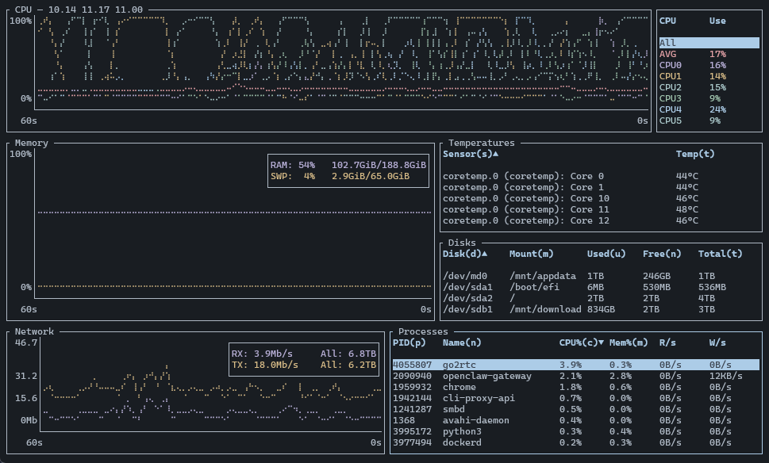
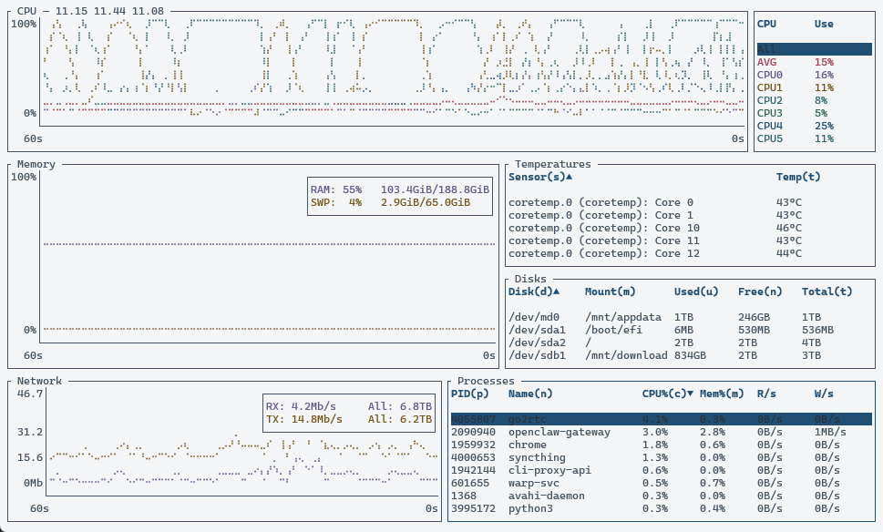

# Flatcap for Windows Terminal

  

<p align="center">
  
</p>

<p align="center">
  
</p>

<p align="center"><sub>Flatcap Slate (dark) above, Flatcap Daylight (light) below.</sub></p>

**Flatcap for Windows Terminal** brings the Flatcap visual system to your shell: matte graphite or soft daylight surfaces, one mineral-blue accent, and the 16 ANSI colors tied to what they mean.

It ships two color schemes, **Flatcap Slate** (dark) and **Flatcap Daylight** (light), plus matching window themes for the tab row and window border. Windows Terminal can switch between them when Windows does.

> The interface organizes. Content takes the foreground. Color informs.

## Install

### Option A: JSON fragment (recommended)

`flatcap-fragment.json` adds the two color schemes without editing your `settings.json`. In PowerShell:

```powershell
$dir = "$env:LOCALAPPDATA\Microsoft\Windows Terminal\Fragments\Flatcap"
New-Item -ItemType Directory -Force $dir | Out-Null
Invoke-WebRequest https://raw.githubusercontent.com/cheycron/flatcap-windows-terminal/main/flatcap-fragment.json -OutFile "$dir\flatcap.json"
```

Use `C:\ProgramData\Microsoft\Windows Terminal\Fragments\Flatcap` to install for every user. Restart the Terminal: **Flatcap Slate** and **Flatcap Daylight** appear under **Color schemes**. A fragment cannot add window themes or change your defaults, so continue with [Use it](#use-it).

### Option B: paste into `settings.json`

> [!WARNING]
> Do not replace your whole `settings.json` with `flatcap-settings.json`. Copy only the entries below.

1. Open the Terminal settings and click **Open JSON file** (bottom left).
2. From [`flatcap-settings.json`](https://github.com/cheycron/flatcap-windows-terminal/blob/main/flatcap-settings.json), copy the two objects of `schemes` into your own `schemes` array.
3. Optional, for the tab row and window border: copy the two objects of `themes` into your `themes` array (add it at the top level if missing).

The complete JSON is also in the [full mapping](https://github.com/cheycron/flatcap-windows-terminal/blob/main/docs/mapping.md#complete-json).

## Use it

### Follow the system light/dark setting

Put this in `settings.json`. It also applies Cascadia Code, a matching intense-text style and a 4px-grid padding to every profile:

<!-- build:snippet -->
```json
{
  "theme": {
    "dark": "Flatcap Slate",
    "light": "Flatcap Daylight"
  },
  "profiles": {
    "defaults": {
      "colorScheme": {
        "dark": "Flatcap Slate",
        "light": "Flatcap Daylight"
      },
      "font": {
        "face": "Cascadia Code",
        "size": 11.25
      },
      "intenseTextStyle": "all",
      "cursorShape": "bar",
      "padding": "16"
    }
  }
}
```
<!-- /build:snippet -->

- `theme` picks the window theme from the Windows appearance, and `colorScheme` follows the **application theme** of that window theme. Use them together.
- To keep the stock window chrome, leave out `theme` or set it to `"system"`; the scheme pair still follows Windows.
- **Installed with Option A only?** The window themes in `theme` do not exist yet. Use `"theme": "system"` (or add the themes as in Option B) and keep the rest.

### One mode, always

Set `"colorScheme": "Flatcap Slate"` or `"Flatcap Daylight"` in one profile, or in `profiles.defaults` for all of them. Set `"theme"` to the window theme with the same name to match the tab row.

## Fonts

Flatcap starts from **Cascadia Code**, which ships with Windows Terminal. Nerd Font builds are optional, for prompts with icons.

<!-- build:fonts -->
| Use | Family (exact) |
| :--- | :--- |
| Default | `Cascadia Code` |
| Prompts with icons (oh-my-posh, starship) | `Cascadia Code NF` |
| No ligatures (logs, literal output) | `Cascadia Mono` |
| No ligatures, with icons | `Cascadia Mono NF` |

Starting size: 15 px from `font.size.code`, which is 11.25 pt in Windows Terminal (1 pt = 1.333 px at 100% scale).
<!-- /build:fonts -->

Use the exact installed family name. The Cascadia `NF` build and the Nerd Fonts `CaskaydiaCove Nerd Font Mono` are different families. Fonts are not bundled and carry their own licenses (Cascadia: SIL OFL 1.1). See the [Flatcap typography guide](https://github.com/cheycron/flatcap-theme/blob/main/docs/typography.md).

## Accessibility

Contrast is computed from the scheme values against the contracts of the [Flatcap core](https://github.com/cheycron/flatcap-theme), and `python3 scripts/build.py --check` fails if the generated files are stale. Text on the background is 7:1 or better in both modes (hues 5:1 or better).

Limits that affect you:

- **Selection has no foreground.** Windows Terminal supports `selectionBackground` only, so some tinted colors fall below 4.5:1 on a selection (3.67:1 at worst in Slate, 4.43:1 in Daylight).
- **ANSI backgrounds (`ESC[4Xm`).** Slate's colors are light, so dark text reads best on them; Daylight's are dark, so light text does. Hard-coded white-on-red is low contrast in Slate. In Daylight, bright white (`ESC[97m`) is the raised white surface and plain white on dark blocks is about 1.1 to 1.3:1.
- **Acrylic and opacity change the colors you see.** Keep `opacity` at 100 and `useAcrylic` off (the defaults) so the contrast figures hold.
- **16 colors only.** Tools that emit their own true-color values (oh-my-posh, starship, `bat`, `delta`) ignore the scheme.
- **Tabs.** The active tab is told apart by fill color only; window themes cannot add another indicator.

Per-pair ratios, ANSI decisions and the full caveats are in the [full mapping](https://github.com/cheycron/flatcap-windows-terminal/blob/main/docs/mapping.md).

## Compatibility

- **Windows Terminal 1.17 or newer** for the `light`/`dark` pair syntax in `theme` and `colorScheme`. On an older version use a single `colorScheme` name.
- JSON fragments need 1.7, window themes 1.16 and `window.frame` 1.19 (Windows 11 only); see the [full mapping](https://github.com/cheycron/flatcap-windows-terminal/blob/main/docs/mapping.md#compatibility-details).
- The schemes were validated against the official JSON schema. A first check in a real Windows Terminal covered `bottom` in Daylight; the remaining colors, bold, dim and inverse have not been checked in full.

## Upgrading from v1

Version 2.0 replaces the Nord-derived v1 palette. The scheme previously named `Flatcap` no longer exists, with no alias on purpose.

1. Delete the old `Flatcap` object from your `schemes` array.
2. Replace `"colorScheme": "Flatcap"` with `"Flatcap Slate"` (or the light/dark pair above).

## Contributing

The JSON files and the generated blocks are produced from `src/theme.json`; do not edit them by hand. Run `python3 scripts/build.py --check` before opening a pull request. Mapping details are in [docs/mapping.md](https://github.com/cheycron/flatcap-windows-terminal/blob/main/docs/mapping.md).

## License

MIT © Cheycron Blaine. See [LICENSE](https://github.com/cheycron/flatcap-windows-terminal/blob/main/LICENSE).

## Support

If Flatcap makes your workspace calmer, you can support its development.

<p align="center">
  <a href="https://www.buymeacoffee.com/cheycron">
    
  </a>
</p>
